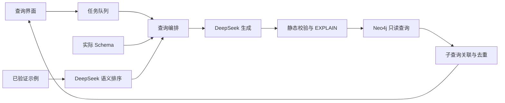

# CodeGraph · 代码图谱 Text2Cypher 智能体

基于课程 PPT 的本地应用。自然语言问题经过实际 Schema、实体定位、知识库检索、DeepSeek 生成、只读校验与 Neo4j 执行，返回数据、拓扑、解释和过程记录。

## 启动

建议使用 Node.js 24 LTS（24.15.0 或更新的 24.x），本机 24.21.0 已验证。Windows 双击 `start.cmd`，然后打开 <http://127.0.0.1:3210>。

也可在 PowerShell 中运行：

```powershell
cd D:\GPU\text2cypher
npm.cmd ci
npm.cmd start
```

本机 `.env` 已按用户提供的配置填写。复制给其他人时，提供 `.env.example`，由对方填写 `.env`，不要分享自己的 API Key。前端只访问本地后端，凭据不随页面或报告下发。

模型使用硅基流动 `deepseek-ai/DeepSeek-V3.2`。配置项包括 API 地址、模型、Neo4j 地址与数据库、`GRAPH_VERSION`、路径上限、结果上限和查询超时。默认图谱版本为 `master-to-dd92845`。修改环境配置后重新启动应用。

## 使用

1. 在查询工作台选择难度，输入自然语言问题。难度是规划提示，实际查询仍以问题语义为准。
2. 同名方法会显示候选，选择具体方法或补充范围后继续。
3. 在结果区切换拓扑、原始数据、Cypher 和执行过程。点击节点或关系查看属性与来源子查询。
4. TXT 批量文件每行一题，最多 30 题。提交后顺序执行，失败题不会中断后续题，可停止任务。
5. 单条和批量结果均可导出 Markdown。查询历史在本地保留最近 300 条，已完成任务保留最近 100 批。
6. 知识库支持编辑、执行验证与人工语义确认。编辑会清除之前的验证状态。
7. 测试评估可以运行全量或单题，查看独立参考查询、生成结果和判定理由，并补充人工判定。

可用于演示的问题：

- 列出所有微服务。
- getAllFood 方法调用了哪些下游服务？（演示同名实体澄清）
- foodsearch.service.FoodServiceImpl.getAllFood 在四跳方法调用内调用哪些下游服务？
- ts-food-service 有哪些 RPC 和 MQ 跨服务依赖？请分别查询并展示拓扑。
- food_delivery 队列的完整发布、路由、消费链路是什么？
- 修改 foodsearch.service.FoodServiceImpl.getAllFood 潜在影响哪些四跳内的上游 API？

## 模块与数据流



- `src/agent.js`：实体识别、消歧、规划、有限修正、依赖传递、图合并与总结。
- `src/graph.js`：实际 Schema、元数据与示例值、Neo4j 访问、执行计划和图对象序列化。
- `src/llm.js`：硅基流动客户端、版本化于源码的 Prompt、示例语义选择。模型不可用时示例检索降级到关键词并记录原因。
- 其余后端模块提供任务队列、原子存储、评估与 Markdown 导出。前端使用原生 HTML/JS 和本地 Cytoscape，无外部 CDN。

Neo4j 的 READ 会话模式用于路由，不能单独当作权限隔离。应用同时阻止更新语句与过程调用，并在实际执行前要求 EXPLAIN 的 queryType 为只读。生产部署应由数据库管理员另配只读账号；本项目按计划仅监听本机地址。

默认每条查询最多返回 200 行、每段可变长度路径最多 6 跳，查询超时 15 秒。结果达到上限时提示可能截断。复杂任务最多 3 个子查询；失败依赖不继续执行，已成功结果仍展示为部分完成。

子查询依赖约定：前一查询返回标量 ID 列，后一查询用 `bindings` 将去重列表绑定到参数。例如：

```json
{"name":"下游路径","cypher":"MATCH (m) WHERE m.nodeId IN $ids RETURN m","parameters":{},"bindings":{"ids":{"query":0,"column":"nodeId"}}}
```

被后续查询引用的子查询标为 `intermediate`，其数据保留供追溯，但不会混入顶层 `rows` 的最终答案。最终行按内容去重，图数据按实体/关系 ID 合并，保留子查询来源。评估的输出契约只提供列含义与类型，不包含参考答案；缺列或类型错误会触发一次修正。

## 数据集与验证状态

- `data/seeds.json`：30 组知识库初始示例，覆盖七类查询模式。保存真实执行时间、行数、预览及语义核对说明。
- `data/knowledge.json`：运行时知识库。启动时如果不存在，会从初始示例创建。仅执行通过且语义核对通过的示例进入检索。
- `data/evaluation.json`：独立的 30 题，分布为 10 简单、12 中等、8 困难。参考查询不会注入生成 Prompt。
- 示例和参考题由 AI 编写，执行与结构语义核对状态明确记录。PPT 要求人工编写/复核的部分需由团队逐条确认，应用不会把 AI 来源标为人工。
- 评估按题目约定的输出列比较去重后的结果集合。缺列、待澄清和截断结果进入复核；不会把“执行成功”直接算作正确。
- 知识库和评测预期结果与 Schema/数据指纹绑定。图谱节点数、关系数或结构发生变化后，旧示例自动停用，旧评测进入复核，不会以共同空结果获得正确判定。
- 正式评分使用固定预期结果，并要求自然语言总结复核。使用 `--resume` 复用任何历史结果的批次只标记为回归汇总，不给出正式 A/B/C/D 等级。
- 评估时为减少成本，跳过独立的自然语言润色调用，仍保存查询结果与确定性的执行总结。日常查询会调用模型生成自然语言解释。
- 本地状态使用串行读改写和临时文件重命名，防止并发修改丢失。

真实图谱使用“归属于、下游调用、目标服务、发布至、路由至、消费自”等关系，与 PPT 的概括名称不完全相同。应用读取实际结构生成查询。MQ 查询需匹配发布和路由的路由键，以免共享默认交换机造成错误关联。

## 测试与评估命令

```powershell
npm.cmd test
node --env-file=.env scripts/probe.js
node --env-file=.env scripts/build-datasets.js
node --env-file=.env scripts/evaluate.js
```

`probe`、数据集验证和评估会访问配置中的真实服务；评估还会消耗模型 API 配额。完整评估可能需要数十分钟，进度持续输出到终端及 `data/evaluation-progress.json`。

只验证部分数据：`node --env-file=.env scripts/build-datasets.js --only=K11,K17`。

只评估部分题：`node --env-file=.env scripts/evaluate.js --ids=S01,M01,H01`。子集不套用 30 题等级。

继续已有评估并重试失败题：`node --env-file=.env scripts/evaluate.js --resume --retry-failed`。此命令复用同题、同图谱版本的历史结果并标注来源；模型或图谱内容发生变化后，应重新执行全量评估，不使用复用选项。

评估证据存于 `reports/`。原始执行结果、参考结果和判定依据均可复查。正确率针对当前版本、题集和模型调用，不代表任意问题均可正确回答。

## 接口

- `GET /api/health`、`GET /api/schema?refresh=true`。
- `POST /api/query`：`{question,level,context?}`；返回任务 ID，`context` 支持 `selectedEntityId` 或澄清文本。
- `POST /api/batch`：`{items:[{question,level}]}`。
- `GET /api/jobs/:id`、`POST /api/jobs/:id/cancel`、`GET /api/jobs/:id/report`。
- `GET /api/history`、`GET /api/history/:id`、`GET /api/history/:id/report`。
- `GET/POST /api/knowledge`、`DELETE /api/knowledge/:id`、`POST /api/knowledge/:id/verify`。
- `GET /api/evaluation`、`GET /api/evaluation/runs`、`POST /api/evaluation/run`、`POST /api/evaluation/review`。

写接口使用 JSON，仅接受本地来源。任务终态包括 `success`、`clarification`、`partial`、`error` 和 `cancelled`；每个结果包含子查询、图数据、解释、范围限制和日志。

官方接口参考：[硅基流动文本生成](https://docs.siliconflow.cn/docs/userguide/capabilities/text-generation)、[Neo4j JavaScript Driver](https://neo4j.com/docs/javascript-manual/current/transactions/)。
